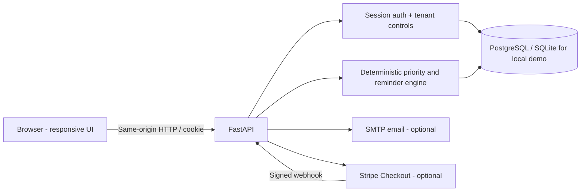

# Dunora — evidence-first revenue operations

**Stop chasing. Start collecting.**

Dunora is a full-stack SaaS MVP for small service businesses that need to convert open invoices into collected cash without losing context, over-contacting customers, or overstating AI confidence. **Built from scratch for Galuxium Nexus V2 (October 2026).** All demo companies are fictional.


### Nexus V2 interface refresh — 20 October 2026

The frontend now uses the reference-inspired premium midnight-blue command-center design, with a responsive sidebar, luminous operational KPI tiles, a four-stage invoice journey, a status-distribution donut, a six-month dual-series SVG chart, and a dense actionable invoice ledger. **All metrics are derived from live per-tenant invoice, payment, and draft data**; charts are not hard-coded demo figures.

The new implementation uses `app/static/v2.css` (overrides the original shared component styles) and `app/static/app.js` for interactive logic. The existing FastAPI endpoints, security checks, ledger invariants, billing logic, and approval workflow remain unchanged. Screenshots: `docs/dashboard-v2-desktop.png` and `docs/dashboard-v2-mobile.png`. The previously generated local walkthrough video was recorded before this design update; record an updated live-site video before final submission.


## Running the application

Requirements: Python 3.11+.

```bash
python3 -m venv .venv
source .venv/bin/activate        # Windows: .venv\Scripts\activate
pip install -r requirements.txt
uvicorn app.main:app --reload
```

Open <http://127.0.0.1:8000/> and select **Explore with an instant demo**. This provisions a separate fictional tenant with 13 invoices and multiple recorded payments. Or register a real tenant and import `app/static/sample.csv`.

### Automated tests

```bash
python -m pytest -q
```

### Local deployment with Postgres

```bash
docker compose up --build
```

Browse <http://localhost:8000>. This runs the API and PostgreSQL with a persisted volume. The Docker credentials are **development-only**.

## The user journey (actually implemented)

1. Sign up, sign in or create an instant isolated demo workspace.
2. Create invoices or import CSV. Check duplicate invoice numbers and validation errors.
3. Monitor balances, due dates, exact recorded payments, priority scores and six-month collection trends.
4. Open an invoice and reconcile a **partial or full** payment with a bank reference. Balances refresh immediately.
5. Mark disputes to automatically stop collection outreach.
6. Open Collection Studio to see exactly *why* each invoice was prioritized.
7. Prepare an editable follow-up, review it and deliberately approve dispatch. With SMTP configured, the email is sent; otherwise it is **logged as a simulation** — no pretend deliveries.
8. Review/export the audit trail; optionally upgrade via Stripe-hosted subscription checkout.

**Accounting invariant:** Outstanding = invoice amount − sum(verified recorded payments). Monetary values are integer paise, and overpayments or duplicate references are rejected.

## System architecture



| Layer | Technology | Why |
|---|---|---|
| Web interface | Dependency-free semantic HTML, CSS and JS | Fast initial load, low hosting cost, single-origin deployment |
| Server | Python FastAPI / Pydantic | Validated APIs and OpenAPI at `/api/docs` |
| Storage | SQLAlchemy and PostgreSQL | Real constraints, persistent multi-tenant operational data |
| Authentication | PBKDF2-SHA256, salted passwords, opaque hashed sessions in HttpOnly cookies | No client-side password or session-token storage |
| Payments | Manual reconciliation; optional Stripe Checkout + signed subscription webhooks | Demo works without false payment confirmations |
| Notifications | Editable human-approved drafts, optional SMTP | Zero auto-outreach; dry-run when email provider absent |
| Shipping | Docker, Compose, Render Blueprint, GitHub Actions | Repeatable local reproduction and deployment |

### Database entities

`orgs(id, name, plan, seeded, stripe_customer_id, stripe_subscription_id)`
`users(id, org_id, email, password_hash, role)`
`login_sessions(id, user_id, token_hash, expires_at)`
`customers(id, org_id, name, email)`
`invoices(id, org_id, customer_id, number, amount_minor, due_date, issued_date, disputed, note)`
`payments(id, org_id, invoice_id, amount_minor, reference, paid_on, source)`
`drafts(id, org_id, invoice_id, subject, body, state)`
`audits(id, org_id, user_id, action, detail, created_at)`

All operational API reads/writes are tenant-scoped. Database uniqueness constraints guard invoice numbers per tenant, customer email per tenant and payment references per tenant. Payment amounts use integer minor units.

## Transparent prioritization — not fake AI

Open invoices begin at score 12. Add `min(50, 2 × days overdue)` and 10 points for unpaid balances ≥₹25,000 or 20 points for ≥₹1,00,000; cap at 100. Disputed invoices are **excluded** from collection targeting. Every invoice shows its contributing factors. This baseline is intentionally explainable; an LLM, when integrated later, must never invent payment facts or override verified ledgers.

## Monetization

| Tier | Monthly proposed INR price | Intended buyers |
|---|---:|---|
| Starter | Free | Solo operators, up to 25 invoices |
| Growth | ₹1,499 | Small teams, unlimited invoices and workflow tools |
| Scale | ₹4,999 | Multi-user organizations; planned advanced governance/integrations |

**Subscription handling:** Configure `STRIPE_SECRET_KEY`, `STRIPE_PRICE_GROWTH`, `STRIPE_PRICE_SCALE`, `STRIPE_WEBHOOK_SECRET` and `APP_URL`. The application creates real Stripe-hosted Checkout Sessions, updates org entitlement only after a verified signed webhook, and processes subscription status updates/deletes. Prices on the site are hypotheses, not proven sales. No live billing without keys. Some plan-entitlement and cancellation UX work remains, as listed below.

## Security and governance

- Passwords are salted and iterated; session tokens are random, hashed at rest, HttpOnly, SameSite=Strict; `COOKIE_SECURE=true` on HTTPS.
- Cross-origin writes are rejected; content security, frame, sniffing and referrer policies are enabled.
- Tenant access checks protect invoices, payments, drafts, workbench, audit and billing.
- Pydantic validation, CSV limits, unique constraints, no floats for money, no overpayment, no duplicate payment references.
- Signed Stripe webhook (SHA256 timestamp tolerance), no trusted frontend redirects for paid status.
- Human sign-off before email; any unconfigured send is explicitly labeled simulated.
- Test suite covers tenant isolation, partial payments, rejected overpayments, duplicate references, disputes, simulated outreach, origin checks, demo access and billing fail-closed behavior.

### Important pre-production work

This is a **functioning, deployment-ready MVP**, not a claim of fully audited enterprise compliance. Before accepting real commercial customers, add: schema migrations (Alembic); distributed rate limiting/WAF; password reset/verification; MFA and role-specific authorizations; robust tenant quota enforcement under concurrency; Stripe webhook event idempotency and entitlement reconciliation with Stripe; portal for cancellation and invoice payment; consent + unsubscribe handling for emails; queue-backed email retries; encrypted backups; observability/SLOs; DPA/retention policy; accessibility audit; load testing; and independent penetration testing. Scale tier features should only be marketed as available after implementation. Using PostgreSQL avoids the loss of SQLite local data on ephemeral filesystems, but Render Free PostgreSQL expires after 30 days and lacks backups; paid persistence would require explicit approval.

## Cloud deployment (Render)

For the no-charge hackathon demo path, use [`DEPLOY_RENDER_FREE.md`](DEPLOY_RENDER_FREE.md); this project now includes a `render.yaml` selecting Free web + Free Postgres. Render free Postgres expires after 30 days and has no backups.


1. Push these files to a new public GitHub repository **with meaningful commits made by the actual team**. Do not fabricate commit history.
2. In Render, use **New Blueprint** and select the repository with `render.yaml`. This version requests **Free** web and **Free** PostgreSQL; review the billing screen before confirming.
3. Render supplies `RENDER_EXTERNAL_URL` automatically and `COOKIE_SECURE=true` comes from the blueprint. No manual `APP_URL` is needed for the public demo. You can override it for a custom domain.
4. Confirm `/api/health` returns `{"ok":true,...}` and run demo signup plus invoices/payments workflow over HTTPS.
5. Optional: set up SMTP credentials for real email only after reviewing consent/compliance. Optional: configure Stripe test keys, create monthly Price IDs in INR, set the webhook endpoint to `https://YOUR_DOMAIN/api/webhooks/stripe` and subscribe to `checkout.session.completed`, `customer.subscription.updated` and `customer.subscription.deleted`.
6. For judges, leave the **instant demo** enabled only with bot protection and resource caps; otherwise create a dedicated demo account and disable public demo (`ALLOW_PUBLIC_DEMO=false`).
7. Record a true screen capture of **the live hosted URL** (2–5 minutes). Follow `docs/DEMO_VIDEO_SCRIPT.md` and place the YouTube or Vimeo link in Devpost.

**No public hosting, Stripe account, verified email delivery or actual customer sales are included in this source archive.** Those steps require your cloud and payment credentials, DNS, and Devpost access. The app does not fabricate them.

## Judges' quick walkthrough

- Instant demo → dashboard → Collection Studio → one priority → generate follow-up → approve → see `Demo logged` badge → invoice detail → record payment → observe changed outstanding and score → Activity log → Plans.
- Technical reviewers: inspect `app/main.py`, `tests/test_api.py`, `Dockerfile`, `render.yaml`, `.github/workflows/tests.yml` and `/api/docs`.

## Originality and responsible use

Written for this conversation during the Galuxium Nexus V2 window. Uses open-source frameworks; no existing proprietary product code or prior hackathon submission has been copied. The challenge's official rules prohibit prior-project submissions, so maintain an accurate provenance record and confirm your build eligibility. See `docs/EXECUTIVE_BRIEF.md` and `docs/SECURITY.md`.
